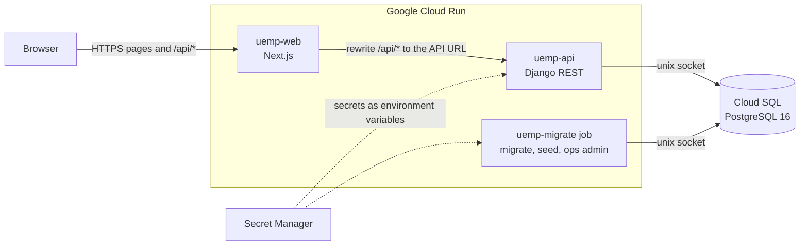

# UEMP: University Education Management Portal

UEMP is a web portal for running a university's academic records. Students register for courses each semester, their department validates the registration, lecturers enter and submit scores, the department that owns the course approves them, and students then see their grades, GPA and CGPA. Department admins manage their own students, lecturers, programs, courses and lecturer allocations. The super admin manages the faculties, departments, academic calendar, users, grading scale and the audit log. It is a Django REST API and a Next.js frontend in one repository, deployed as two Google Cloud Run services on Cloud SQL for PostgreSQL.

## Live links

| What | Link |
| --- | --- |
| App (custom domain) | https://uemp.abrahamalgorithm.tech |
| App (Cloud Run URL, fallback) | https://uemp-web-taqq76r7ua-ew.a.run.app |
| API documentation (Swagger UI) | https://uemp-api-taqq76r7ua-ew.a.run.app/api/docs/ |
| Source code | https://github.com/AbrahamAlgorithm/uemp |

Use the Cloud Run URL if the custom domain does not resolve yet. Both serve the same app.

## Test credentials

Every account uses the same password: `Demo@2026`. Sign in with the email, the matric number or the staff ID.

| Role | Email | Matric no. / Staff ID | Useful for |
| --- | --- | --- | --- |
| Student | student1@uemp.test | CSC/2024/0001 | 300-level Computer Science, has a carry-over (CSC 201), has not registered yet |
| Lecturer | lecturer1.csc@uemp.test | CVU/CSC/073 | Teaches CSC 301 (returned for corrections) and CSC 309 (draft) |
| Department admin | admin.csc@uemp.test | CVU/CSC/017 | Computer Science |
| Department admin | admin.mth@uemp.test | CVU/MTH/012 | Mathematics, to see department scoping |
| Lecturer (Maths) | lecturer1.mth@uemp.test | CVU/MTH/052 | Teaches MTH 301, a service course that Computer Science students take |
| Super admin | superadmin@uemp.test | CVU/REG/010 | Whole university |

The seed also creates other students (one with a returned registration, one with a submitted registration) and result sheets in every state. `python manage.py seed_demo` prints all 31 accounts.

## Evaluator walkthrough

About ten minutes. Use a private window per role, or sign out between steps. Steps 1 to 7 follow one course through its whole life; steps 8 and 9 cover borrowed courses and access control.

1. **Register with a carry-over (student1).** The dashboard shows a registration card ("You haven't registered yet") and a carry-over, CSC 201. Open **My Courses**, choose **Start course registration**. CSC 201 is already ticked and marked Carry-over. Tick CSC 309. The side panel shows 6 / 24 units. Tick more courses and the ones that would pass 24 units grey out. Submit and confirm. The status becomes **Awaiting validation**.
2. **Validate (admin.csc).** Open **Registrations**. Under Submitted you will see Chiamaka Okafor's form. Open it and choose **Validate**. A validated form is locked for the student. (To see the other path, return the form with a reason instead; the student then sees the reason and can resubmit.)
3. **Enter scores (lecturer1.csc).** Open **My Courses**, then CSC 309. The class list now has three students, including Chiamaka, because only validated registrations appear. Choose **Enter scores**, then **Download template** (the arrow beside it offers CSV as well as Excel). Fill the file in:

   ```
   matric_no,name,ca,exam
   CSC/2024/0001,Chiamaka Okafor,30,45
   CSC/2024/0002,Ifeanyi Okonkwo,25,40
   CSC/2024/0004,Yusuf Danjuma,15,20
   ```

   Choose **Import from Excel/CSV** and select the file. The preview shows three changes and nothing is saved yet. Add a row with a matric number that is not on the list and the preview shows an error and refuses to apply. Apply the good file, then **Submit**. The totals are 75 (A), 65 (B) and 35 (F). If any score had been left blank, the app would warn that blanks are recorded as 0.
4. **Reject and resubmit.** As admin.csc, open **Results**, then CSC 309, and choose **Reject** with a reason of at least 10 characters. As lecturer1.csc, **My Courses** now shows the sheet as Rejected with the feedback inline. Change a score and submit again.
5. **Approve (admin.csc).** Open the sheet and choose **Approve**. Then sign in as superadmin and open the same sheet: the super admin can read it but has no approve button, and the API answers `403`.
6. **The student sees the result (student1).** In **My Courses** under 2026/2027, CSC 309 shows A with 75. The semester GPA and the CGPA on the dashboard move from 2.67 to 3.25. CSC 201 still shows no grade because its sheet is not approved. Use **Print result statement** for the printable statement.
7. **Reopen (admin.csc).** Reopen CSC 309 with a reason. The grade disappears from the student's page at once and the CGPA returns to 2.67. The lecturer sees the sheet back in Draft with the reason.
8. **Borrowed courses.** Sign in as lecturer1.mth. MTH 301's class list holds a Computer Science student (CSC/2024/0002) and a Mathematics student. Mathematics owns the course, so admin.mth approves its results. Sign in as admin.csc and search the Results page for MTH 301: it is not there. Registration works the other way round: a Computer Science student's form, including any MTH 301 line on it, is validated by admin.csc.
9. **Access control to try.**
   - As student1, open `/admin`. You are sent back to the student area. In the API documentation, run `GET /api/auth/csrf/`, then `POST /api/auth/login/` with the student's credentials, and `GET /api/users/` answers `403`.
   - As admin.csc, open **Students** and check that only Computer Science levels appear. Ask for an Electrical Engineering student's record by id (`GET /api/students/{id}/`) and you get `404`.
   - As lecturer1.csc, `GET /api/lecturer/offerings/{id}/sheet/` for another lecturer's offering answers `404`.
   - As student1, `PATCH /api/auth/me/profile/` with `{"matric_no": "CSC/2024/9999"}` answers `400` "This field can only be changed by an administrator." A new phone number is accepted.
   - As superadmin, suspend a student in **Users**. That student's next request fails even though their session had not expired. Open **Academic Calendar** and close registration: students see "Registration is closed".
   - As superadmin, open **Audit Log**. Every step above is there; click a row to see the before and after values side by side.

`python scripts/smoke_test.py <base url>` runs the access-control checks and a sign-in for each role against a live deployment.

## Tech stack

| Layer | Technology | Why |
| --- | --- | --- |
| Backend | Python 3.12, Django 5.2 LTS, Django REST Framework | Mature auth, ORM and migrations; permission and serializer classes match the role rules |
| API docs | drf-spectacular | The OpenAPI schema and Swagger UI come from the code, so they cannot drift |
| Auth | SimpleJWT in httpOnly cookies, Argon2 | Tokens stay out of page scripts; refresh rotation and a blacklist give real sign-out |
| Database | PostgreSQL 16 | Check constraints, a partial unique index for the one current semester, `jsonb` for audit values |
| Frontend | Next.js 15 (App Router), TypeScript | One service serves the UI and proxies the API, so cookies stay first-party |
| UI | Tailwind CSS, shadcn/ui, TanStack Table | Accessible components and sortable, searchable tables |
| Forms | React Hook Form and Zod | One schema validates a form and types its values |
| Import and export | openpyxl, the csv module | Excel and CSV score import with a preview; CSV report downloads |
| Hosting | Google Cloud Run, Cloud SQL, Secret Manager | Containers without servers, managed Postgres, secrets outside the repo |
| CI | GitHub Actions (`api.yml`, `web.yml`) | Runs the tests, the linter and the build on every push |

## Architecture



The browser only talks to the Next.js origin. Next.js forwards `/api/*` to Django, so cookies are first-party and CORS is not needed in normal use. Each API request passes the Django security middleware, cookie JWT authentication with CSRF, a role permission class, department scoping, and then a service layer that writes the audit row in the same transaction as the change. Details are in [docs/architecture.md](docs/architecture.md).

## Repository structure

```
uemp/
├── docker-compose.yml        # postgres:16 + api + web for local development
├── .env.example              # every environment variable, documented
├── .github/workflows/        # api.yml (pytest), web.yml (lint + build)
├── docs/                     # architecture, database, permissions, security, result workflow
├── infra/deploy.sh           # builds, deploys and smoke-tests on Cloud Run
├── scripts/smoke_test.py     # checks a running deployment
├── backend/                  # Django API
│   ├── config/               # settings (base, dev, prod), urls, wsgi
│   ├── apps/                 # accounts, academics, courses, registrations,
│   │                         # results, reports, audit
│   ├── core/                 # permissions, department scoping, shared viewsets
│   └── tests/
└── frontend/                 # Next.js app
    └── src/
        ├── app/              # /login and the /student, /lecturer, /department, /admin areas
        ├── components/       # app shell, tables, dialogs, forms, ui/ (shadcn)
        ├── hooks/
        ├── lib/api/          # one function per API operation
        └── middleware.ts     # role redirects (convenience only)
```

## Local setup

Requirements: Docker with Compose v2.

```bash
cp .env.example .env                                            # optional, the defaults work
docker compose up --build
docker compose exec api python manage.py seed_demo              # safe to run again
docker compose exec api python manage.py seed_demo --reset      # wipe and reload the demo rows
```

| URL | What |
| --- | --- |
| http://localhost:3000 | Web app |
| http://localhost:8000/api/docs/ | Swagger UI |
| http://localhost:8000/api/health/ | Health check |
| http://localhost:8000/admin/ | Django admin (needs a superuser, see below) |

Sign in with the accounts in [Test credentials](#test-credentials). The seed loads two faculties, three departments, five sessions, courses, registrations and result sheets in every state, and 31 accounts on the `uemp.test` domain; every account uses `SEED_PASSWORD` (default `Demo@2026`). The compose `api` service runs `migrate` and then `runserver`; the production image never migrates on start. Postgres is published on port 5433 so it does not clash with a local Postgres. A Django admin account is only needed for `/admin/`: `docker compose exec api python manage.py createsuperuser`.

## Testing

```bash
cd backend
pip install -r requirements.txt     # or: uv pip install -r requirements.txt
pytest                              # 310 tests
pytest --cov                        # with coverage

cd ../frontend
npm ci
npx tsc --noEmit && npm run lint && npm run build
```

The backend suite has 310 tests and 96% line coverage over `apps`, `core` and `config` (migrations, settings and the test files are excluded). It covers the role and scope rules of every endpoint, the registration and result workflows, GPA and CGPA arithmetic, score import, reports and CSV, and the audit rows. The tests need a PostgreSQL reachable at `DATABASE_URL`, which `docker compose up db` provides. `scripts/smoke_test.py` checks a running deployment (needs the `requests` package).

## Deployment

`infra/deploy.sh` deploys everything from the committed source on Google Cloud:

```bash
PROJECT_ID=<project> OPS_ADMIN_EMAIL=<private address> ./infra/deploy.sh
```

- **Artifact Registry** holds one image per commit for the API and the web app.
- **Cloud SQL** runs PostgreSQL 16 (`uemp-db`, `db-f1-micro`). The API reaches it through the Cloud SQL socket.
- **Secret Manager** holds `DJANGO_SECRET_KEY`, `DATABASE_URL`, `SEED_PASSWORD`, `OPS_ADMIN_EMAIL` and `OPS_ADMIN_PASSWORD`. The script creates any that are missing and gives the API's service account access to only those.
- **Cloud Run** runs `uemp-api` and `uemp-web` with at least one instance each. The web image has the API URL built in, and the script sets the API's allowed hosts, CSRF origins and CORS origins from the real service URLs.
- **The `uemp-migrate` job** runs `migrate`, `seed_demo` and `create_ops_admin` from the API image. To reload the demo data, run `gcloud run jobs execute uemp-migrate --region europe-west1 --wait --args="-c,python manage.py migrate --noinput && python manage.py seed_demo --reset && python manage.py create_ops_admin"`.
- **Custom domain.** The script maps `uemp.abrahamalgorithm.tech` to `uemp-web` and prints the DNS record to add. The certificate is issued once the record resolves.

The script ends with a smoke test of the web URL, and `python scripts/smoke_test.py <url>` repeats the access-control checks from outside.

## Assumptions

- **Borrowed courses.** A course belongs to one department, and that department approves its results whichever departments the students come from. A student's own department validates their registration, including borrowed courses on it.
- **Blank scores count as 0.** A blank CA or exam stays blank on the sheet and is only counted as 0 when the sheet is submitted, after the lecturer confirms.
- **Grades are stored at submit.** Total, grade and grade point are worked out when the sheet is submitted and kept. A later change to the grading scale does not alter submitted or approved results.
- **National grading scale.** The default is the Nigerian 5-point scale (A 70 to 100 down to F 0 to 39). Only the super admin can change it, with a confirmation.
- **Carry-overs and CGPA.** A failed course comes back as a carry-over and is pre-selected at registration. When it is retaken, both attempts count in the CGPA, so the earlier F still weighs on the average. Only approved results count.
- **Registration window and lock.** A student can register only while the super admin has the semester's registration open, limited to 24 units. A validated registration is locked until the department returns it.
- **Class lists.** Only validated registrations appear on a class list and can be scored.
- **Levels.** A student's level in an earlier session is worked out from their current level, one level down per year.
- **Editable profile fields.** Students can change their phone number, address and date of birth (the student must be at least 14). Staff can change their phone number. Every other field is managed by an administrator.
- **Accounts are never deleted.** They are deactivated or suspended, so the audit trail always names a real account.

## Known limitations and future work

- **Payments.** Fee payment and other student services are not built. They would be a separate module.
- **Email and SMS.** There are no notifications and no self-service password reset. A user who forgets a password asks their department admin.
- **Absent marking.** There is no ABS status for a student who missed an exam. A blank score is counted as 0.
- **Throttling.** Sign-in limits are kept in each instance's memory, so two instances count separately. Redis-backed throttling and Cloud Armor rate limiting would fix that.
- **Fail detection.** A failed course is a grade of F, by letter. A custom scale where a passing letter carries 0 points, or an F with points, is not handled; detection by grade point would be more robust.
- **Final-year rules.** Carry-over rules for final-year students (extra attempts, spill-over, graduation checks) are not modelled.
- **Dependency audit.** The remaining `npm audit` findings need major upgrades (Next 16, shadcn 1.0) and are listed in [docs/security.md](docs/security.md).

## Documentation

- [docs/architecture.md](docs/architecture.md): components, request flow, technology choices, deployment topology
- [docs/database.md](docs/database.md): ER diagram and one line per table
- [docs/permissions.md](docs/permissions.md): permission matrix, enforcement and separation of duties
- [docs/security.md](docs/security.md): authentication, throttling, secrets, deploy check, audit results, limitations
- [docs/result-workflow.md](docs/result-workflow.md): result sheet states, grading, GPA, import and audit
