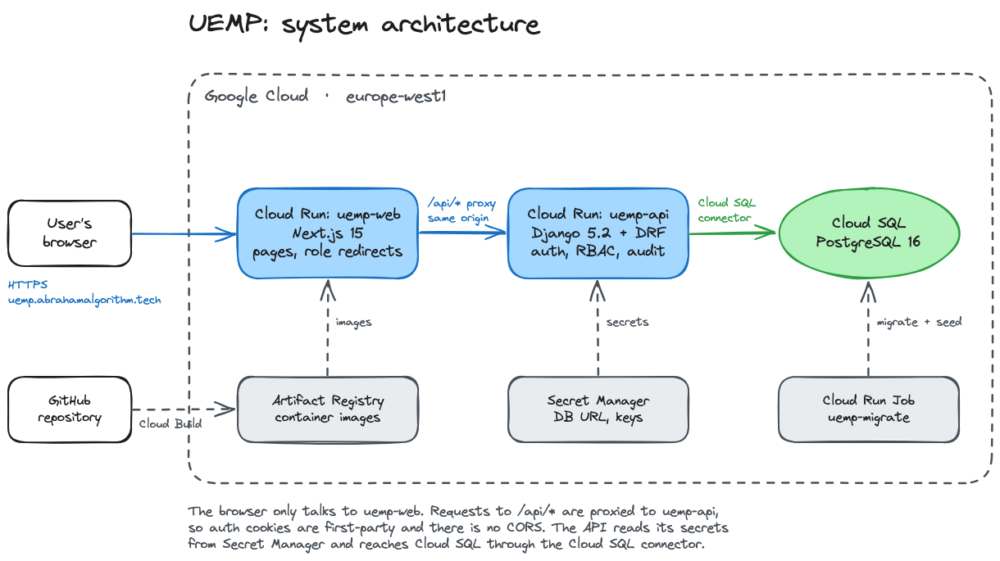

# UEMP: University Education Management Portal

Web portal for university academic records: students register for courses, departments validate registrations, lecturers enter scores, departments approve them, and students see their grades, GPA and CGPA. A Django REST API and a Next.js frontend, deployed on Google Cloud Run with Cloud SQL (PostgreSQL).



## Live links

| What | Link |
| --- | --- |
| Frontend | https://uemp.abrahamalgorithm.tech |
| API | https://uemp-web-taqq76r7ua-ew.a.run.app |
| API docs | https://uemp-api-taqq76r7ua-ew.a.run.app/api/docs/ |
| Source | https://github.com/AbrahamAlgorithm/uemp |

## Test credentials

Password for every account: `Demo@2026`. Sign in with the email, matric number or staff ID.

| Role | Email | ID | Notes |
| --- | --- | --- | --- |
| Student | student1@uemp.test | CSC/2024/0001 | Has a carry-over, not yet registered |
| Lecturer | lecturer1.csc@uemp.test | CVU/CSC/073 | Teaches CSC 301 and CSC 309 |
| Department admin | admin.csc@uemp.test | CVU/CSC/017 | Computer Science |
| Department admin | admin.mth@uemp.test | CVU/MTH/012 | Mathematics |
| Lecturer | lecturer1.mth@uemp.test | CVU/MTH/052 | Teaches MTH 301, taken by CS students |
| Super admin | superadmin@uemp.test | CVU/REG/010 | Whole university |

`seed_demo` creates 31 accounts and prints them all.

## Tech stack

| Layer | Technology | Why |
| --- | --- | --- |
| Backend | Python 3.12, Django 5.2, Django REST Framework | Auth, ORM and permissions built in |
| API docs | drf-spectacular | Schema generated from the code |
| Auth | SimpleJWT in httpOnly cookies, Argon2 | Tokens out of page scripts, real sign-out |
| Database | PostgreSQL 16 | Check constraints, partial indexes, `jsonb` audit values |
| Frontend | Next.js 15, TypeScript | Serves the UI and proxies the API |
| UI | Tailwind CSS, shadcn/ui, TanStack Table | Accessible components, sortable tables |
| Forms | React Hook Form, Zod | One schema validates and types a form |
| Import/export | openpyxl, csv | Excel/CSV score import, CSV reports |
| Hosting | Cloud Run, Cloud SQL, Secret Manager | Managed containers, database and secrets |
| CI | GitHub Actions | Tests, lint and build on `backend/` and `frontend/` changes |

## Architecture

The browser talks only to Next.js, which proxies `/api/*` to Django, so cookies are first-party and CORS isn't needed. Details in [docs/architecture.md](docs/architecture.md).

## Repository structure

```
uemp/
├── docker-compose.yml        # postgres + api + web for local development
├── .env.example              # environment variables
├── .github/workflows/        # api.yml (pytest), web.yml (lint + build)
├── docs/                     # architecture, database, permissions, security, result workflow
│   └── diagrams/             # architecture image, schema.dbml
├── infra/deploy.sh           # Cloud Run deployment
├── scripts/smoke_test.py     # checks a running deployment
├── backend/                  # Django API
│   ├── config/               # settings (base, dev, prod), urls, wsgi
│   ├── apps/                 # accounts, academics, courses, registrations,
│   │                         # results, reports, audit
│   ├── core/                 # permissions, department scoping, shared viewsets
│   └── tests/
└── frontend/                 # Next.js app
    └── src/
        ├── app/              # /login and the /student, /lecturer, /department, /admin areas
        ├── components/       # shell, tables, dialogs, forms, ui/ (shadcn)
        ├── hooks/
        ├── lib/api/          # one function per API operation
        └── middleware.ts     # role redirects
```

## Local setup

Requires Docker with Compose v2.

```bash
cp .env.example .env    # optional
docker compose up --build
docker compose exec api python manage.py seed_demo            # add --reset to reload
```

| URL | What |
| --- | --- |
| http://localhost:3000 | Web app |
| http://localhost:8000/api/docs/ | Swagger UI |
| http://localhost:8000/api/health/ | Health check |
| http://localhost:8000/admin/ | Django admin (`createsuperuser` first) |

Postgres is on port 5433. Demo accounts use `SEED_PASSWORD` (default `Demo@2026`).

## Testing

```bash
cd backend && pip install -r requirements.txt
pytest --cov                                        # 317 tests, 97% coverage

cd ../frontend && npm ci
npx tsc --noEmit && npm run lint && npm run build
```

Backend tests need PostgreSQL (`docker compose up db`). `python scripts/smoke_test.py <url>` checks a running deployment.

## Deployment

```bash
PROJECT_ID=<project> OPS_ADMIN_EMAIL=<email> ./infra/deploy.sh
```

Builds both images with Cloud Build, deploys `uemp-api` and `uemp-web` to Cloud Run, runs the `uemp-migrate` job, maps the custom domain and runs a smoke test. Secrets are kept in Secret Manager.

Reload demo data:

```bash
gcloud run jobs execute uemp-migrate --region europe-west1 --wait \
  --args="-c,python manage.py migrate --noinput && python manage.py seed_demo --reset && python manage.py create_ops_admin"
```

## Documentation

- [Architecture](docs/architecture.md)
- [Database](docs/database.md), [schema.dbml](docs/diagrams/schema.dbml)
- [Permissions](docs/permissions.md)
- [Security](docs/security.md)
- [Result workflow](docs/result-workflow.md)
