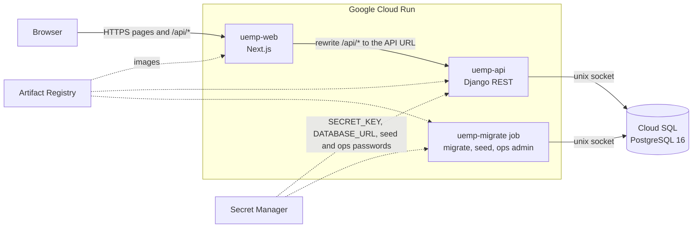

# Architecture

UEMP is two Cloud Run services and a database. A Next.js service serves the pages and forwards `/api/*` to a Django REST service, which reads and writes PostgreSQL on Cloud SQL.

## Components

| Component | What it does |
| --- | --- |
| `uemp-web` | Next.js 15 (App Router). Serves the four role areas and proxies every `/api/*` request to `uemp-api`, so the browser only ever talks to one origin. |
| `uemp-api` | Django 5.2 and Django REST Framework, run by gunicorn. All business rules, permissions and the audit trail live here. |
| Cloud SQL | PostgreSQL 16 holding every record. The API reaches it over the Cloud SQL unix socket. |
| `uemp-migrate` | A Cloud Run job that runs `migrate`, `seed_demo` and `create_ops_admin` from the same image as the API. The API image itself never migrates on start. |
| Secret Manager | `DJANGO_SECRET_KEY`, `DATABASE_URL`, `SEED_PASSWORD`, `OPS_ADMIN_EMAIL` and `OPS_ADMIN_PASSWORD`, mounted as environment variables for the API and the job. |
| Artifact Registry | One image per commit for the API and for the web app. |

## Request flow

Every API request passes the same layers, in this order:

1. **Next.js middleware** (`frontend/src/middleware.ts`). Redirects a signed-out visitor to `/login` and a signed-in user away from another role's area. It reads a role cookie that the server never trusts, so this is a convenience for the user and not a security control.
2. **Rewrite.** Next.js forwards `/api/*` to the Django service. The cookies are first-party because the browser never calls the API origin, so no CORS is needed in normal use.
3. **Django security middleware.** `SecurityMiddleware` (HTTPS redirect, HSTS), `CorsMiddleware`, `CsrfViewMiddleware`, and `XFrameOptionsMiddleware` (`DENY`).
4. **Cookie JWT authentication** (`apps/accounts/authentication.py`). Reads the httpOnly access cookie, validates the token, loads the user, rejects accounts that are not `ACTIVE` on every request, and enforces CSRF on every authenticated request.
5. **Permission classes and department scoping.** `HasRole(...)` allows or refuses the endpoint. Querysets are then filtered to what the user may see (`core/scoping.py`), so another department's record is a `404`.
6. **Service layer.** Views stay thin. `apps/*/services.py` holds the state transitions and checks (for example `submit_registration`, `submit_sheet`, `approve_sheet`) and raises `409 Conflict` for an action the current state doesn't allow.
7. **Audit in the same transaction.** `audit.record()` writes the audit row inside the `transaction.atomic()` block of the change it records, and refuses to run outside one. A change is never saved without its record.

## Backend apps

| App | Responsibility |
| --- | --- |
| `accounts` | Users, student and staff profiles, sign-in, cookies, throttling, profile self-service |
| `academics` | Faculties, departments, programs, sessions, semesters and the registration window |
| `courses` | Course catalogue and per-semester offerings with their lecturer |
| `registrations` | Semester registrations, validation, carry-over rules, the 24-unit cap |
| `results` | Result sheets, score entry and import, grading scale, GPA and CGPA |
| `reports` | Role dashboards, My Courses data, the result statement and the five reports |
| `audit` | Append-only audit log and its read API |
| `core` | Permission classes, scoping, shared viewsets, spreadsheet-safe export helpers |

## Frontend

`frontend/src/app` has one folder per role (`student`, `lecturer`, `department`, `admin`). Every call to the API goes through `src/lib/api/remote.ts`, which maps the API's JSON to typed objects. Shared building blocks (tables, dialogs, forms, breadcrumbs) are in `src/components`. Session state is held in `session-provider.tsx`, and `http.ts` adds the CSRF header and refreshes an expired access token once on a `401`.

## Why these technologies

| Choice | Reason |
| --- | --- |
| Django and DRF | Mature auth, ORM and migrations; permission and serializer classes map directly onto the role rules. |
| PostgreSQL | Check constraints, partial unique indexes (one current semester) and `jsonb` for audit before and after values. |
| Cookie JWT (SimpleJWT) | httpOnly cookies keep tokens away from page scripts, and refresh rotation with a blacklist allows real sign-out. |
| Argon2 | Memory-hard password hashing, the first hasher in `PASSWORD_HASHERS`. |
| Next.js | One deployable that serves the UI and proxies the API, which keeps cookies first-party. |
| shadcn/ui, Tailwind, TanStack Table | Accessible components and sortable, searchable tables without a custom design system. |
| React Hook Form and Zod | One schema validates a form and types its values. |
| Cloud Run | Containers with scale to zero or a minimum instance, no servers to manage. |
| Cloud SQL | Managed PostgreSQL with backups, reached from Cloud Run without a public IP. |
| Secret Manager | Keeps keys and passwords out of the repository and the image. |

## Deployment topology

`infra/deploy.sh` is idempotent. It builds both images from the committed source, creates or reuses the Cloud SQL instance and the secrets, deploys `uemp-api`, runs the migrate job, deploys `uemp-web` with the API URL baked in at build time, maps the custom domain, and ends with a smoke test. Both services run with at least one instance (`--min-instances 1`) so the first request after a quiet period isn't a cold start. See the README for the commands.
