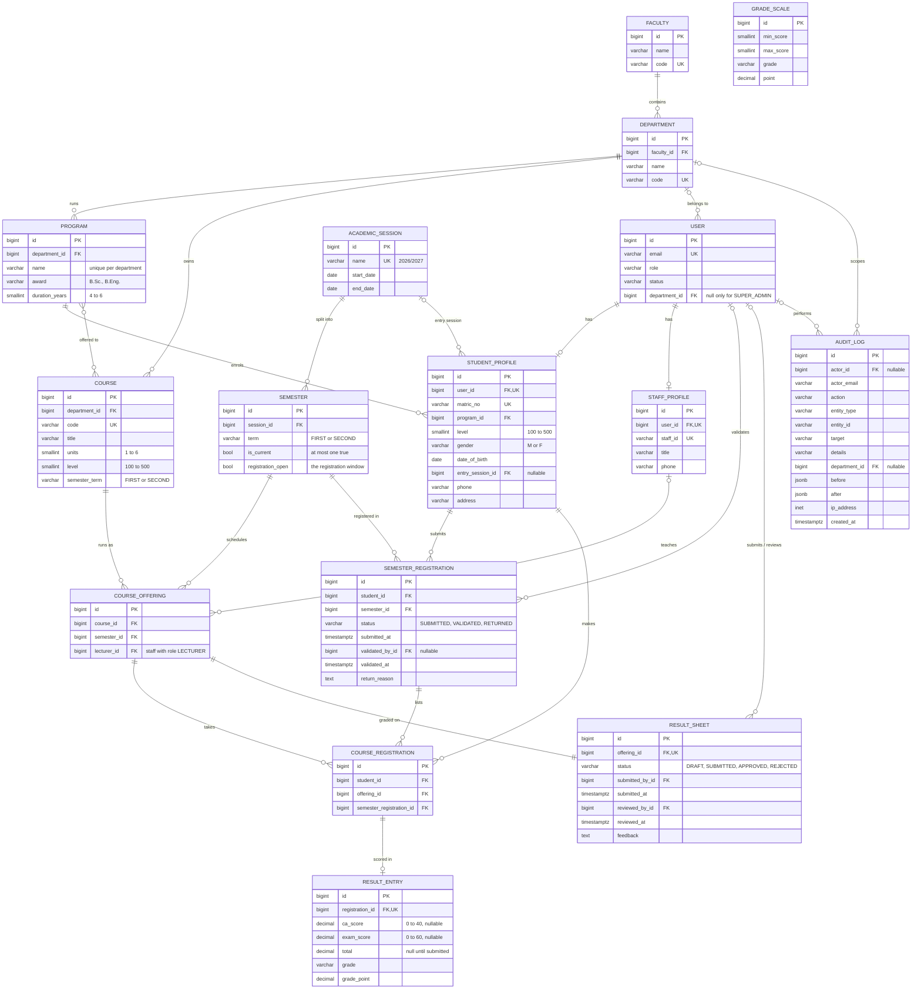

# Database Design

PostgreSQL 16. Every table has a `bigint` id and `created_at` / `updated_at` from `core.models.TimeStampedModel` (the audit log keeps only `created_at`). Foreign keys between academic records use `PROTECT`, so a row that is still referenced can't be deleted.

## Entity-relationship diagram

## Tables

- `academics_faculty`: top level of the university structure; `code` is unique.
- `academics_department`: a department inside a faculty; `code` is unique.
- `academics_program`: a degree programme run by a department, with its award such as B.Sc. or B.Eng.; `(department, name)` is unique and `duration_years` is between 4 and 6.
- `academics_academicsession`: an academic year such as `2026/2027`, with optional start and end dates; `name` is unique.
- `academics_semester`: the FIRST or SECOND term of a session; `(session, term)` is unique, and a partial unique index on `is_current = true` allows only one current semester. `registration_open` is the registration window that students need open to submit.
- `accounts_user`: the sign-in account for every role; `email` is unique and `department` is null if and only if `role = SUPER_ADMIN` (a check constraint). Accounts are never deleted, only set to ACTIVE, INACTIVE or SUSPENDED.
- `accounts_studentprofile`: student details, one per user and deleted with it; `matric_no` is unique, `level` is one of 100, 200, 300, 400, 500, the department is read through `program`, and gender (M or F), date of birth and `entry_session` are optional. `entry_session` is a protected reference to the session the student started in.
- `accounts_staffprofile`: staff details (staff ID, title, phone) for lecturers, department admins and super admins, one per user and deleted with it; `staff_id` is unique and is one of the identifiers accepted at sign-in.
- `courses_course`: a catalogue course owned by a department; `code` is unique, `units` is 1 to 6, `level` is one of 100 to 500, and `semester_term` is FIRST or SECOND.
- `courses_course_programs`: join table for the programmes a course is offered to.
- `courses_courseoffering`: a course running in a given semester; `(course, semester)` is unique, `lecturer` must be a staff profile whose user is a LECTURER (checked in `clean()` and `courses.services.assign_lecturer`, not by the database) and is set to null if the profile is deleted, and saving a new offering creates its result sheet.
- `registrations_semesterregistration`: one form per student per semester, `(student, semester)` unique, with a `status` of SUBMITTED, VALIDATED or RETURNED. Only VALIDATED forms put a student on a class list. It records who validated it and when, and the reason when a form is returned.
- `registrations_courseregistration`: a course on a student's form; `(student, offering)` is unique and `semester_registration` points at the form it belongs to. The service keeps the student and semester in step with the form, because the database can't check across tables. The 24-unit cap (`MAX_UNITS_PER_SEMESTER`) is checked in application code.
- `results_gradescale`: maps a score band to a grade and grade point; `0 <= min_score <= max_score <= 100`.
- `results_resultsheet`: one per offering, created as DRAFT when the offering is created; `status` is indexed, and the submitter and reviewer are nullable references to users that can't be deleted while referenced.
- `results_resultentry`: a student's score for one registration, at most one per registration. `ca_score` (0 to 40) and `exam_score` (0 to 60) are each nullable, so a lecturer can save CA only, exam only, both or neither. `total`, `grade` and `grade_point` stay null until the sheet is submitted, when blank scores count as 0.
- `audit_auditlog`: an append-only record of who changed what, with display text in `target` and `details` and an optional `department` for department-level activity feeds; indexed on `(entity_type, entity_id)` and on `created_at`. `actor` and `department` are set to null when their row is deleted, while `actor_email` keeps the name, and it is read-only in the admin.
- `token_blacklist_outstandingtoken` and `token_blacklist_blacklistedtoken`: SimpleJWT's record of issued refresh tokens and the ones revoked by rotation or sign-out.
