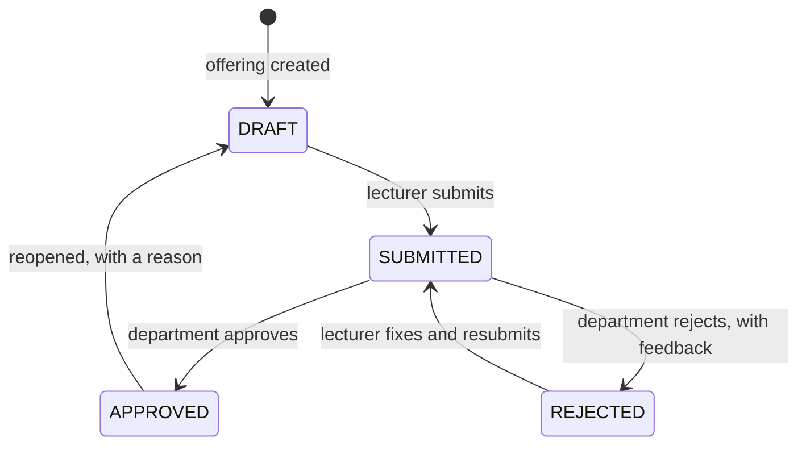

# Result Workflow

How a course's scores go from the lecturer to the student: who can do what, how grades and GPAs are worked out, and what the audit log records along the way. The code lives in `backend/apps/results` (`services.py` for the transitions, `grading.py` for grades and GPA, `imports.py` for spreadsheet import).

## States

Every course offering has one result sheet. It moves through four states:

- **DRAFT**: the lecturer is entering scores. Nobody else acts on it.
- **SUBMITTED**: scores are locked and waiting for the department.
- **REJECTED**: sent back with feedback. The lecturer can edit and submit again.
- **APPROVED**: published. Students see these results and they count towards GPA and CGPA.

Any other move (approving a draft, editing a submitted sheet, reopening a rejected one) returns `409` with a plain message.

## Who can do what

| Action | Who | Endpoint |
| --- | --- | --- |
| Enter, save and import scores | The offering's lecturer, while the sheet is DRAFT or REJECTED | `PATCH /api/lecturer/offerings/{id}/sheet/entries/`, `POST …/sheet/import/` |
| Submit | The offering's lecturer, from DRAFT or REJECTED | `POST /api/lecturer/offerings/{id}/sheet/submit/` |
| Approve | Department admin of the course's department, from SUBMITTED | `POST /api/result-sheets/{id}/approve/` |
| Reject (feedback required) | Department admin of the course's department, from SUBMITTED | `POST /api/result-sheets/{id}/reject/` |
| Reopen (reason required) | Department admin of the course's department, or super admin, from APPROVED | `POST /api/result-sheets/{id}/reopen/` |
| View sheets | Department admins see their department's courses; super admin sees all | `GET /api/result-sheets/` |

The lecturer who teaches the course enters its marks, and the department that owns the course checks them. The super admin oversees every department and can reopen an approved sheet when something has to be corrected, but cannot approve or reject. That keeps separation of duties: whoever publishes a result belongs to the department responsible for the course, and the registry can send results back without being able to publish them.

Access errors follow the rest of the API. A lecturer asking for another lecturer's offering, or a department admin asking for another department's sheet, gets `404`, so the record's existence isn't revealed. A role that can never do the action (a student, a lecturer on the review endpoints, a super admin approving) gets `403`.

Feedback and reasons are required and capped at 1000 characters.

## Class list

A student is on a course's class list only when their course registration belongs to a **validated** semester registration. Submitted or returned registrations don't appear and can't be scored.

The sheet gets an empty score row for each validated student the first time it is read or saved, and only while it is DRAFT or REJECTED. A submitted or approved sheet keeps the students it was submitted with. A student validated after that joins the class list when the sheet is reopened.

## Scoring

- CA is out of 40 and the exam out of 60, with at most two decimal places.
- A blank score stays blank (null). It is never stored as 0.
- When the sheet is submitted, total = (CA or 0) + (exam or 0). If any student has a blank score, the lecturer must confirm before submitting: the API returns `400` with the list of incomplete students and "Blank scores will be recorded as 0." until `confirm_incomplete` is true.
- Changing a score clears that row's stored total and grade. They are worked out again at the next submit.

## Grades and the grading scale

Total, grade and grade point are worked out **at submit** from the active grading scale and stored on each row. Approving doesn't recalculate them, so a later change to the scale never alters results that were already submitted or approved. A total of 69.5 rounds to 70 before the band is looked up.

The default is the Nigerian 5-point scale (`NATIONAL_GRADE_SCALE` in `grading.py`, the only place it is defined):

| Marks | Grade | Point |
| --- | --- | --- |
| 70–100 | A | 5 |
| 60–69 | B | 4 |
| 50–59 | C | 3 |
| 45–49 | D | 2 |
| 40–44 | E | 1 |
| 0–39 | F | 0 |

The `GradeScale` table holds the active scale. A migration fills it with the national scale on a new database, and `seed_demo` restores it.

The scale is set by national policy and should not normally change. Only the super admin can change it, and the request must carry `confirm: true` (`PUT /api/grade-scale/`). The bands must cover 0–100 with no gaps or overlaps, use each grade once, have points from 0 to 5, and keep F as the band starting at 0, because carry-overs and pass rates look for F. `POST /api/grade-scale/reset/` puts the national scale back. `GET /api/grade-scale/` returns the bands and `is_default`, which is true when the active scale matches the national one.

## GPA and CGPA

Only results on APPROVED sheets count.

- GPA for a semester = Σ(course units × grade point) ÷ Σ(course units), over the student's approved results in that semester, rounded to 2 decimal places.
- CGPA = the same calculation over all of the student's approved results.

A failed course comes back as a carry-over. When it is retaken, both attempts count: the earlier F stays in the CGPA alongside the new grade, and the units are counted twice in "units attempted". "Units passed" counts courses with any grade other than F.

Students see their approved results grouped by semester, with GPA per semester, CGPA, and a carry-over flag on retaken courses (`GET /api/student/results/`). Reopening a sheet hides its results from students until it is approved again.

## Borrowed courses

A course belongs to one department, and that department approves its results, whichever departments the students come from. For example, MTH 301 is approved by the Mathematics admin even when Computer Science students take it. The Computer Science admin can't see that sheet. The CS students still see their MTH 301 results once Mathematics approves them.

## Score import

Lecturers can fill in scores in a spreadsheet instead of the grid.

1. **Template.** `GET /api/lecturer/offerings/{id}/sheet/template/?format=xlsx` (or `csv`) downloads the class list with columns `matric_no`, `name`, `ca` and `exam`, with any saved scores filled in. The file is named like `CSC301_2026-2027_First_scores.xlsx`.
2. **Preview.** Upload the file to `POST …/sheet/import/` with `dry_run=true`. Nothing is written. The response lists every row as `change`, `unchanged` or `error`, with the old and new values and a summary count.
3. **Apply.** Upload again with `dry_run=false`. If any row has an error, nothing is saved and the same report comes back with `400`. Otherwise every change is saved in one transaction, through the same service as the grid.

Rules:

- Only DRAFT or REJECTED sheets accept imports (`409` otherwise). Files must be `.xlsx` or `.csv` and no larger than 1 MB.
- Headers are matched case-insensitively. `matric_no`, `ca` and `exam` are required, and `name` is ignored.
- Each row replaces both scores for that student, and a blank cell clears the score. Students missing from the file keep their scores.
- A row is an error if the matric number is missing, isn't on the validated class list, or appears twice, or if a score isn't a number, is out of range, or has more than two decimal places.
- In the app, the lecturer must save or discard unsaved grid edits before importing.

## Audit trail

Every save and transition writes one audit row in the same database transaction as the change, so a change is never saved without its record, or the reverse. A save or import that changes no scores writes nothing.

| Action | Written when | `before` / `after` | `details` |
| --- | --- | --- | --- |
| `SCORES_SAVED` | Scores are saved from the grid | `after.changes`: one item per changed score, `{matric_no, field, before, after}` | "3 scores changed" |
| `RESULTS_IMPORTED` | An import is applied | `after.file` (the uploaded filename) and `after.changes` as above | "12 scores changed from CSC301_scores.xlsx" |
| `RESULTS_SUBMITTED` | The lecturer submits | `after.count` (students) and `after.blanks` (students with a blank score recorded as 0) | "30 students, 2 blank scores recorded as 0" |
| `RESULTS_APPROVED` | The department approves | status only | — |
| `RESULTS_REJECTED` | The department rejects | `after.feedback` | the feedback |
| `RESULTS_REOPENED` | A sheet is reopened | `after.reason` | the reason |
| `GRADE_SCALE_UPDATED` | The super admin changes the scale | `before.bands` and `after.bands` | the new bands, e.g. "A 70-100 (5), …" |
| `GRADE_SCALE_RESET` | The scale is reset to the national default | as above | as above |

Every row also records the actor and their email, the entity (`results.resultsheet` with the sheet id, or `results.gradescale` with no id for the whole scale), a target such as "CSC 301 2026/2027 First semester", the department that owns the course (so department admins see activity on their courses even when the super admin acted), the client IP, and the time. Sheet rows store the status before and after the change.

The lecturer's submissions page and the review page build each sheet's timeline from the submitted, approved, rejected and reopened rows.
